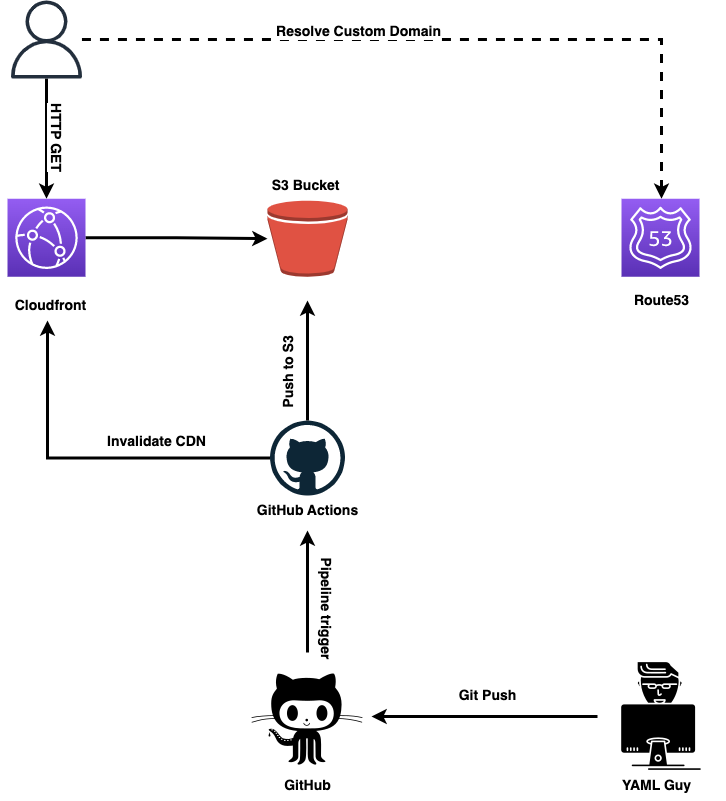

# ettoreciarcia.com

Personal site and blog, built with [Astro](https://astro.build). Content is plain Markdown; the site is
statically built and served from an S3 bucket behind CloudFront, deployed by GitHub Actions.

## Architecture Overview



## Getting started

Requires Node 22 (see `.nvmrc`).

```sh
npm ci          # install dependencies
npm run dev     # http://localhost:4321 with live reload
npm run build   # static site + Pagefind search index in ./dist
npm run preview # serve ./dist locally (search works only here, not in dev)
npm run check   # type-check pages and content front matter
```

Set `PUBLIC_GA_ID` at build time to enable Google Analytics (CI passes it from the `TRACKING_ID` secret).
GA is loaded only after the visitor accepts the cookie banner (`src/components/CookieConsent.astro`);
without `PUBLIC_GA_ID` there is no banner and no analytics. What is collected is described on `/privacy/`.

## Writing content

Every entry is a folder with an `index.md` and its images next to it. The folder name is the URL slug.

| Collection     | Folder                         | URL                     |
| -------------- | ------------------------------ | ----------------------- |
| Articles       | `src/content/blog/<slug>/`     | `/publication/<slug>/`  |
| Talks          | `src/content/talks/<slug>/`    | `/event/<slug>/`        |
| Projects       | `src/content/projects/<slug>/` | `/project/<slug>/`      |
| Certifications | `src/content/certifications/<slug>/` | `/certification/<slug>/` |

### New article

```sh
mkdir src/content/blog/31-my-article
```

`src/content/blog/31-my-article/index.md`:

```md
---
title: "My article"
date: 2026-01-15
summary: One sentence shown in lists and in the RSS feed.
category: AI            # Cloud & Kubernetes | Homelab | Personal | AI
tags: [Kubernetes, AI]
image: ./featured.png   # optional, shown on the page and used as og:image
draft: true             # optional, hides it from the build
---

Body in Markdown. Images are referenced relatively: 
```

Front matter is validated by the schema in `src/content.config.ts`; the build fails on a typo.
After a substantive revision to an article, add `updated: YYYY-MM-DD` to its front matter.
Use the actual revision date, on or after `date`. It appears below the publication details
and is included in social metadata, structured data and the sitemap. Without `updated`,
no revision date is displayed; article lists and RSS keep their publication order.

Article pages also suggest up to three related articles, ranked by shared tags, then matching
category, then newest publication date. The current article and unrelated entries are excluded;
production suggestions use published articles only.

Animated GIFs over ~1 MB should be converted to video, which is 10–20× smaller:

```sh
ffmpeg -i demo.gif -movflags +faststart -an -c:v libx264 -preset slow -crf 26 -pix_fmt yuv420p \
  -vf "scale='min(1600,iw)':-2" public/media/<slug>/demo.mp4
ffmpeg -ss 0.5 -i public/media/<slug>/demo.mp4 -frames:v 1 -update 1 -q:v 8 public/media/<slug>/demo.jpg
```

and embedded with `<video class="gif-video" src="/media/<slug>/demo.mp4" poster="/media/<slug>/demo.jpg"
width="W" height="H" muted loop playsinline preload="none" aria-label="…"></video>`: it plays like a GIF but
only downloads when scrolled into view. For terminal recordings use `-crf 32 -tune stillimage` and max width 1200.

A highlighted note is an HTML aside:

```html
<aside class="callout">

Markdown inside works, keep the blank lines.

</aside>
```

### Other data

- `src/data/profile.json` — bio metadata, work experience, education (drives `/`, `/experience/`).
- `src/data/logos/` — company logos for the work timeline; `work[].logo` in `profile.json` is the file name
  (square image on a white background works best; without one the timeline shows a plain dot).
- `src/data/bio.md` — the paragraph on the home page.
- `src/data/events.yaml` — the table on `/events/`.
- `src/data/history-of-my-career.md` — the `/history-of-my-career/` page.
- `public/` — files served as-is (CV PDF under `uploads/`, slides, killer.sh simulations).

## URL compatibility

The site replaced a Hugo (HugoBlox) site in October 2026. Every public URL of the old site still resolves:
content slugs are the old folder names, tag slugs follow Hugo's rules (`/tags/ci/cd/` included) and the
few paths that changed (`/talks/`, `/project/`, paginated lists) are redirects declared in `astro.config.mjs`.
The RSS feed stays at `/index.xml`.

## Deploy

Pushing to `main` runs `.github/workflows/deploys3.yaml`: `npm ci`, `npm run build`, `aws s3 sync` of `dist/`
and a CloudFront invalidation. `make deploy-dev` / `make deploy-prod` do the same from a workstation.
